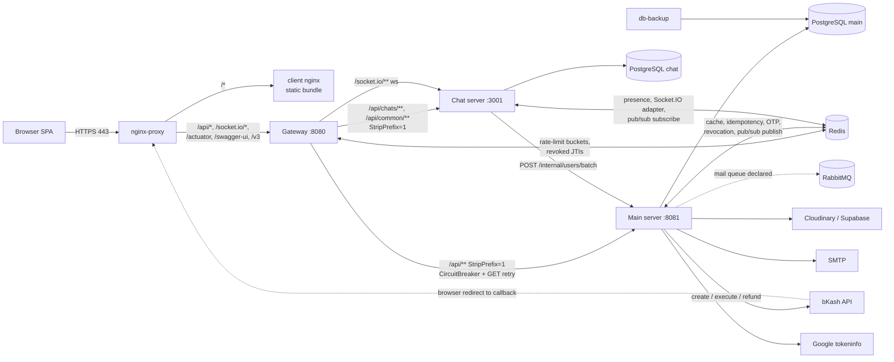
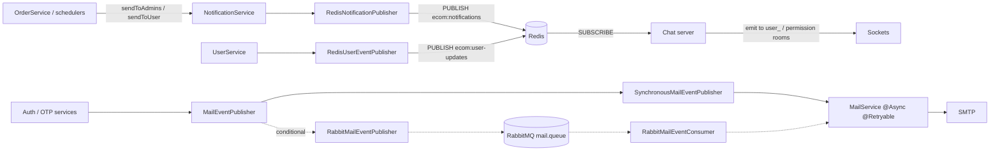
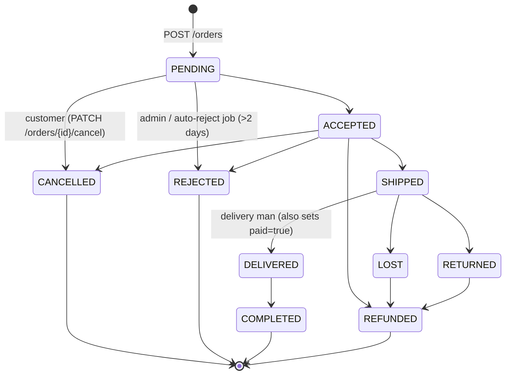
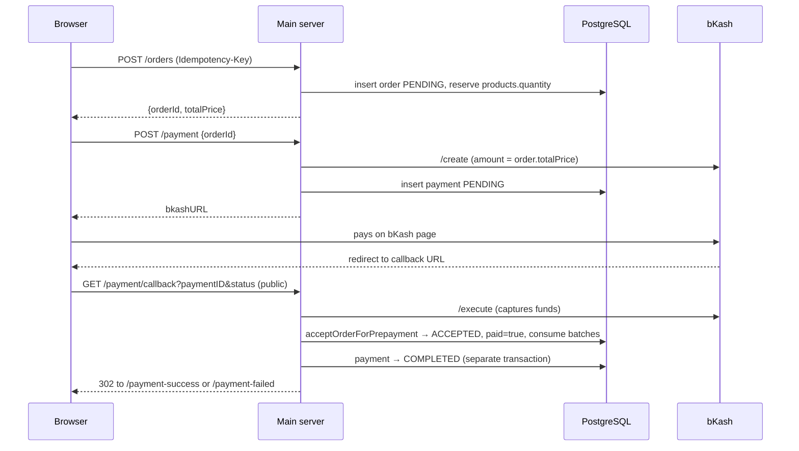

# Architecture

## System Overview

A monorepo microservices e-commerce platform. All traffic enters through an Nginx reverse proxy (`nginx-proxy`) which routes API and WebSocket requests to the Spring Cloud Gateway, and serves the React client. No individual service is directly exposed to the host network.

## Service Map

```
Nginx Reverse Proxy (:80 → 301, :443 TLS)  ← sole public entry point
        │
        ├── /api/* /socket.io/*  → Spring Cloud Gateway (:8080, internal)
        │                              │                │
        │                              ▼                ▼
        │                    Main Server (:8081)   Chat Server (:3001)
        │                    (Spring Boot 3.5)     (Node.js / Socket.IO)
        │                              │                │
        │                    ├── PostgreSQL (Main DB) ├── PostgreSQL (Chat DB: chats, msgs)
        │                    ├── Redis 7              ├── Redis 7 (pub/sub & user cache)
        │                    └── RabbitMQ 3           └── HTTP Internal -> Main Server (:8081)
        │
        └── /*               → React Client Nginx (:80, internal)
```

### Component & Communication Diagram



## Docker Network Isolation

| Network    | Members                                          | Purpose                           |
|------------|--------------------------------------------------|-----------------------------------|
| `frontend` | nginx-proxy, gateway, client                     | Client ↔ Gateway traffic          |
| `backend`  | nginx-proxy, gateway, server, chat-server        | Internal service communication    |
| `data`     | server, chat-server, gateway, redis, postgres, postgres-chat, rabbitmq | Data layer access |

- **Nginx Proxy** spans `frontend` and `backend` — it routes external traffic to either the client or gateway.
- **Client** is on `frontend` only — it cannot reach `server` or `chat-server` directly.
- **Gateway** spans `frontend`, `backend`, and `data` — it needs Redis for token revocation checks.

## Request Routing

### Nginx Proxy Layer

| Path Pattern       | Upstream                        | Notes                                |
|--------------------|---------------------------------|--------------------------------------|
| `/api/*`           | `http://gateway:8080`           | All REST API traffic                 |
| `/socket.io/*`     | `http://gateway:8080`           | WebSocket upgrade (proxy headers)    |
| `~ ^/(swagger-ui\|v3\|chats/v3\|actuator)` | `http://gateway:8080` | Gateway's own Swagger UI / API docs / actuator (not the server's) |
| `/*`               | `http://client:80`              | React SPA (catch-all)               |

Port 80 only returns `301` to HTTPS; all routing above happens on the 443 server block.

### Gateway Rules

| Route ID             | Path Predicate                  | Upstream                  | Notes                          |
|----------------------|---------------------------------|---------------------------|--------------------------------|
| `chat-service-ws`    | `/socket.io/**`                 | `ws://chat-server:3001`   | WebSocket upgrade              |
| `chat-service-api`   | `/api/chats/**`, `/api/common/**` | `http://chat-server:3001` | Chat REST & uploads, StripPrefix=1 |
| `main-service-api`   | `/api/**`                       | `http://server:8081`      | All other requests (catch-all), StripPrefix=1 |

The `main-service-api` catch-all has a CircuitBreaker (`mainServiceCB`) + GET retry (2 retries on `SERVICE_UNAVAILABLE`).

### How StripPrefix Works

The `/api` prefix is a **routing marker** added by the React client (`VITE_API_PATH=/api`). It tells Nginx "this is an API request, not a page request." Backend services never see `/api` — the Gateway strips it via `StripPrefix=1`, which removes the first path segment before forwarding:

```
/api/products       → StripPrefix=1 → /products       → server:8081
/api/chats/123      → StripPrefix=1 → /chats/123      → chat-server:3001
/socket.io/?EIO=4   → (no strip)    → /socket.io/...  → chat-server:3001
```

### End-to-End Request Trace

**REST API request** (`GET /api/products`):
```
Browser                → GET http://yoursite.com/api/products
Nginx (:80)            → matches location /api/ → forwards to gateway:8080/api/products  (path unchanged)
Gateway (:8080)        → matches Path=/api/** → StripPrefix=1 → forwards GET /products to server:8081
Main Server (:8081)    → receives GET /products → returns response
```

**WebSocket connection** (`/socket.io/?EIO=4&transport=websocket`):
```
Browser                → GET http://yoursite.com/socket.io/?EIO=4&transport=websocket
Nginx (:80)            → matches location /socket.io/ → upgrades to WebSocket → forwards to gateway:8080
Gateway (:8080)        → matches Path=/socket.io/** → forwards as-is to ws://chat-server:3001
Chat Server (:3001)    → Socket.IO accepts handshake → persistent WebSocket connection established
```

## Data Flow by Feature

### REST API (HTTP)
```
Client → Gateway (JWT validation) → Server/Chat Server → PostgreSQL/Redis → response
```
Every hop re-verifies the JWT (Gateway, Main Server, Chat Server). The full authentication sequence diagram is in [security.md → JWT Validation Flow](./security.md#jwt-validation-flow).

### Real-time Chat (Hybrid Architecture)
```
Client ──HTTP POST /api/chats/:id/messages──▶ Gateway ──▶ Chat Server
                                                            │
                                                       PostgreSQL (persist message in transaction)
                                                            │
                                                 ┌──────────┴──────────┐
                                                 ▼                     ▼
                                     emit message-receive        emit chat-updated
                                     to chat_${chatId}           to each user_${participantId}
                                     (Active conversation)       (Sidebar preview & unread badge)
```

- **Room Architecture:** Clients join their personal room `user_${userId}` on connect (for notifications & sidebar updates), and dynamically join/leave active rooms `chat_${chatId}` via `join-chat` and `leave-chat` events when selecting conversations.
- **Presence Tracking:** Redis Set `presence:${userId}` stores active socket IDs with 120s TTL, refreshed via a 60s server heartbeat. Emits `user-presence` `{userId, online, lastSeen}` on 0↔1 count transitions.
- **Typing Indicators:** Client emits `typing {chatId}` (2s throttle); server verifies `socket.rooms.has(chatId)` and broadcasts `user-typing` to `chat_${chatId}` excluding sender. Instant dismissal on message arrival.

### Real-time Notifications (Redis Pub/Sub → WebSocket)
```
Server ──publish──▶ Redis (ecom:notifications) ──subscribe──▶ Chat Server ──Socket.IO emit──▶ Client
```
Note: Main Server publishes `NotificationEvent` to Redis via `NotificationPublisher`. Chat Server subscribes and emits `notification` events to `user_${id}` or `admin_room` over the existing authenticated Socket.IO connection.

### Email / Async Jobs
```
Intended:  Server ──publish──▶ RabbitMQ mail.queue ──consume──▶ RabbitMailEventConsumer ──▶ MailService ──▶ SMTP
Fallback:  Server ──▶ SynchronousMailEventPublisher ──▶ MailService (@Async, @Retryable ×3) ──▶ SMTP
```
- `MailEventPublisher` has two implementations. `RabbitMailEventPublisher`/`RabbitMailEventConsumer` are guarded by `@ConditionalOnBean(RabbitTemplate.class)`; `SynchronousMailEventPublisher` is registered when the Rabbit publisher is missing.
- `@ConditionalOnBean` on component-scanned classes is evaluated before auto-configuration registers `RabbitTemplate`, so in practice the **synchronous fallback is the active path**. Verify with the startup log ("Sending mail synchronously (no MQ)"). See [audit F-17](../.context/2026-10-25-system-audit.md).
- After 3 failed SMTP attempts the mail is logged and dropped (`MailService.recoverSendEmail`); there is no dead-letter store.
- `service.exchange` / `service.queue` are declared in `RabbitMQConfig` but have no publisher or consumer.

### Messaging & Event Inventory

| Channel | Transport | Publisher | Consumer | Delivery guarantee |
|---|---|---|---|---|
| `mail.exchange` → `mail.queue` (`mail.send`) | RabbitMQ direct | `RabbitMailEventPublisher` | `RabbitMailEventConsumer` | Durable queue, no DLQ, broker has no volume |
| `service.exchange` → `service.queue` | RabbitMQ topic | — | — | Unused |
| `ecom:notifications` | Redis pub/sub | `NotificationService` → `RedisNotificationPublisher` | Chat `socketNotificationHandler` | Fire-and-forget; lost while chat is down |
| `ecom:user-updates` | Redis pub/sub | `RedisUserEventPublisher` | Chat `socketUserUpdateHandler` | Fire-and-forget |
| `POST /internal/users/batch` | HTTP chat → server | — | `InternalUserController` | Sync; `X-Internal-Service-Key`, 5s timeout, chat falls back gracefully |

The chat server does **not** use RabbitMQ.



## Order, Payment & Inventory Lifecycle

### Order State Machine

Allowed transitions are defined in `OrderStatus.canTransitionTo()`:



Status changes go through `OrderService.updateStatus` (admin / delivery man), `OrderService.cancel` (customer), `OrderService.acceptOrderForPrepayment` (bKash callback) and `OrderService.notifyAndRejectPendingOrders` (daily job, `OrderRejectScheduler`). Every change writes a row to `order_history`.

### Inventory Model (two ledgers)

| Ledger | Table / column | Meaning |
|---|---|---|
| Sellable quantity | `products.quantity` | Units available to new orders (already net of PENDING reservations) |
| Purchase batches | `stock_items.remaining` (FIFO by `stocks.created_at`) | Physical units per purchase batch, with `purchase_price` |
| Profit records | `sales` | One row per batch slice consumed by an accepted order |

| Event | `products.quantity` | `stock_items.remaining` / `sales` |
|---|---|---|
| Stock purchase (`StockService.create` / `addItem`) | `+= q` | new batch, `remaining = q` |
| Order created (`OrderService.create`) | `-= q` atomically (`decreaseStockIfAvailable`, fails if insufficient) | — |
| Order accepted (`updateStatus` / `acceptOrderForPrepayment`) | — | FIFO consume of batches locked with `PESSIMISTIC_WRITE`, items processed in product-id order; `sales` rows inserted |
| Cancel / reject / return from PENDING, ACCEPTED or SHIPPED | `+= q` (`increaseStock`) | not reversed (see [audit F-04](../.context/2026-10-25-system-audit.md)) |

Prices are always taken from the database (`OrderItem.unitPrice = product.price` at order creation); price fields sent by the client are ignored.

### Prepaid Checkout (bKash)



Known gaps in this flow (non-atomic capture/accept, no reconciliation, callback URL mismatch) are tracked in the [audit](../.context/2026-10-25-system-audit.md) (F-01 – F-03).

## Resilience & Outage Fallback Matrix

The platform implements an **intentionally polyglot fallback architecture** (see [ADR 006](./decisions/006-resilience-and-fallbacks.md)). A single uniform fallback would cause either cascading database failure (thundering herd on PostgreSQL) or cross-node race conditions (split-brain in RAM).

| Concern | Active Storage | Fallback on Redis Down | Behavior / Safety Guarantee |
| :--- | :--- | :--- | :--- |
| **Product & Catalog Cache** | Redis `products::*` | `SimpleCacheErrorHandler` ➜ PostgreSQL | Transparent fallback to DB; zero 500 errors |
| **Order Idempotency** | Redis `idempotency:*` (30s lock) | `IdempotencyAspect` ➜ PostgreSQL index | Partial unique index `uq_orders_user_idempotency` blocks duplicates |
| **Payment Tokens (bKash)** | Redis `bkash:token` | `ResilientCacheService` ➜ In-Memory RAM | Token cached per instance via `ConcurrentHashMap` |
| **Chat User Profiles** | Redis `cache:user:*` | `UserService.js` ➜ Main Server HTTP API | Calls `POST /internal/users/batch` to fetch from DB |
| **Chat Rate Limiting** | Redis `ratelimit:msg:*` | Local per-socket sliding window | Limits to 5 msgs/sec in-memory per socket |
| **Online Presence** | Redis `presence:*` Sets | Graceful degradation | Presence dots hide (offline); messaging is uninterrupted |
| **Typing Throttles** | Redis `typing:*` | Drop typing broadcast | Message delivery is never blocked |
| **Admin Notifications** | Redis `ecom:notifications` | Caught & logged as warning | Core order creation transaction succeeds |
| **Token Blacklist Check** | Redis `v1:revokedAccessTokens` | 1. Caffeine cache (< 15s)<br>2. **Fail-Closed:** `503 Service Unavailable` | Banned or revoked credentials never leak |

## Ports (Local Dev)

| Service      | Port |
|--------------|------|
| Gateway      | 8080 |
| Main Server  | 8081 |
| Chat Server  | 3001 |
| Client       | 5173 |
| PostgreSQL   | 5432 |
| Redis        | 6379 |
| RabbitMQ     | 5672 / 15672 (mgmt) |

## Key Technology Decisions

- **Spring Cloud Gateway** — centralized CORS, JWT validation, rate limiting, and request logging. Individual services do not handle CORS.
- **Database-per-Service (PostgreSQL)** — Independent databases: `postgres` for Main Server (Flyway migrations) and `postgres-chat` for Chat Server (automated DDL initialization). Chat Server resolves user details via internal HTTP (`POST /internal/users/batch`) with Redis multi-tier caching (TTL 10m).
- **Hybrid Real-Time Rooms** — Personal rooms (`user_${id}`) for notifications and sidebar updates; active conversation rooms (`chat_${id}`) for live messaging and typing indicators.
- **Dual-Layer Idempotency** — Redis distributed lock for fast concurrency rejection + PostgreSQL unique partial constraint for hard persistence safety.
- **Interface Decoupling** — Cache, notifications, user cache evictions, and mail delivery decoupled behind interfaces (`CacheService`, `NotificationPublisher`, `UserEventPublisher`, `MailEventPublisher`).
- **Redis** — used by all three backend services: Spring Cache (Main Server), Socket.IO adapter pub/sub (Chat Server), rate-limit bucket storage (Gateway + Main Server).
- **No dedicated sync endpoint for chat** — reconnect recovery uses standard `GET /chats/:id?afterId=` forward pagination.
- **Timestamps** — always `java.time.Instant` (UTC ISO-8601) on the JVM side. Never `LocalDateTime`.
