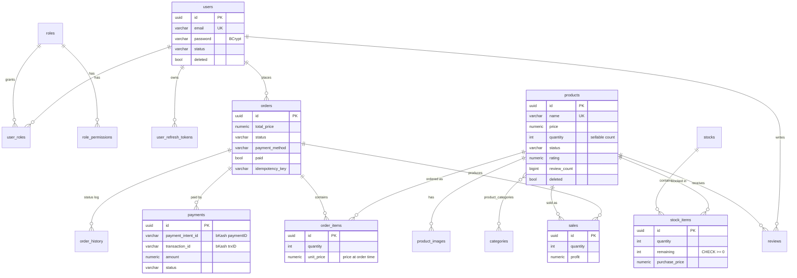
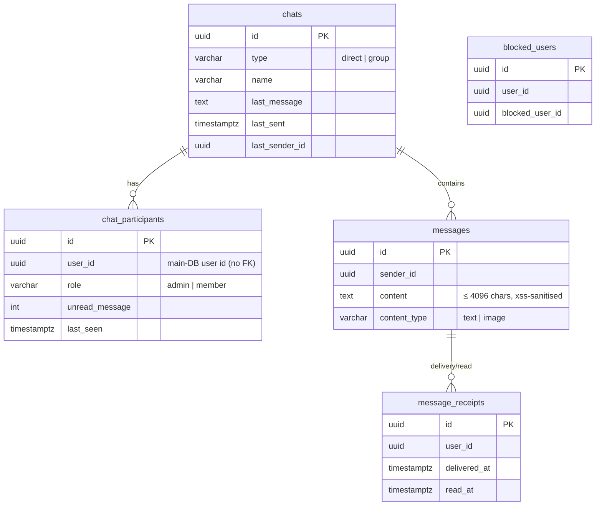

# Data Model

There are two PostgreSQL databases plus Redis. Each database has exactly one owning service, and no service reads another service's tables.

| Store | Owner | Schema source | Contents |
|---|---|---|---|
| `postgres` (main DB) | Main Server | Flyway: `server/src/main/resources/db/migration/V1–V4` | Users, roles, catalog, stock, orders, payments, sales, reviews, CMS |
| `postgres-chat` (chat DB) | Chat Server | Raw SQL run by `initDb`: `server_chat/migrations/V1–V2` | Chats, participants, messages, receipts, blocks |
| Redis | Shared, with key prefixes per concern | — | Cache, idempotency, OTP, token revocation, rate limits, presence, pub/sub |

The chat DB stores only user **IDs**. It resolves names and avatars through `POST /internal/users/batch` on the Main Server and caches them in Redis.

## Conventions

| Concern | Rule |
|---|---|
| Primary keys | `UUID`, generated in the application as UUIDv7 (`@UuidV7`). They are time-ordered, so `ORDER BY id` ≈ creation order. |
| Timestamps | `TIMESTAMPTZ` in the DB, `java.time.Instant` in Java, UTC ISO-8601 on the wire. |
| Money | `NUMERIC(19,2)` in the DB, `BigDecimal` in Java. `double`/`float` are never used. |
| Optimistic locking | `version INT` on every `BaseEntity` table (`@Version`). JPQL bulk `UPDATE`s do **not** bump it. |
| Auditing | `created_by` / `updated_by` (user UUIDs) are filled by Spring Data auditing on `AuditableEntity` tables. |
| Soft delete | `users.deleted` and `products.deleted` are booleans. No other table is soft-deleted. |
| Enums | Stored as `VARCHAR` holding the enum **name** (`@Enumerated(STRING)`). `users.gender` is the exception: it is stored as `SMALLINT`. |
| Schema changes | Main DB: always a new Flyway file `V<n>__<desc>.sql`; never edit applied files. `ddl-auto: none`. |

## Main Database

Standalone tables with no foreign keys: `banners`, `faqs`, `blogs`.

### Tables by domain

| Domain | Table | Key columns / notes |
|---|---|---|
| **Identity** | `users` | `email` UNIQUE. `status` ∈ NOT_VERIFIED, ACTIVE, SUSPENDED, INACTIVE, DELETED, BANNED. `deleted` is the soft-delete flag. |
| | `roles`, `role_permissions` | Seeded by V3: Super Admin, Admin, Delivery Man, User (fixed UUIDs `…0001`–`…0004`). Permissions are stored as strings (`SUPER_ADMIN_ACCESS`, …). |
| | `user_roles` | M:N join, `ON DELETE CASCADE` from both sides. |
| | `user_refresh_tokens` | `jti` UNIQUE, `status` ∈ ACTIVE, REVOKED. Revoked rows are deleted daily once older than 1 day. |
| **Catalog** | `products` | `name` UNIQUE. `status` ∈ COMING_SOON, AVAILABLE, STOCK_OUT, DISCONTINUED. `rating` and `review_count` are denormalised from `reviews`. The first image is read through `@Formula`. |
| | `product_images` | `ON DELETE CASCADE` from product. Maximum `app.product.max-image-count` (5) per product. |
| | `categories`, `product_categories` | `categories.name` UNIQUE. |
| **Inventory** | `stocks` | A purchase batch header with `total_cost`. |
| | `stock_items` | One row per product per batch. `remaining` is decremented FIFO when orders are accepted. `CHECK (remaining >= 0)` (V4). |
| **Orders** | `orders` | `UNIQUE (user_id, idempotency_key)`. `name`, `phone` and `address` are copied per order. `status` follows the [state machine](./architecture.md#order-state-machine). |
| | `order_items` | `unit_price` is frozen from `products.price` when the order is created. |
| | `order_history` | Append-only log of status changes (`from_status`, `to_status`, `changed_by_user_id`, `comment`). |
| **Payments** | `payments` | `status` ∈ PENDING, COMPLETED, FAILED. Indexed on `order_id`, `payment_intent_id` and `transaction_id`. **No uniqueness** on any of them. |
| | `sales` | One row per batch slice consumed by an accepted order, with `profit = price − purchase_price`. Feeds the sales analytics and reports. |
| **Reviews** | `reviews` | `UNIQUE (user_id, product_id)`, so one review per user per product. `rating` has no CHECK. |
| **CMS** | `banners`, `faqs`, `blogs` | `blogs.title` UNIQUE. `blogs.status` ∈ DRAFT, PUBLISHED. Limits come from config: `app.cms.max-total-banners` 20, `max-active-banners` 5, `max-total-faqs` 10. |

`V1` also creates `chats`, `chat_participants`, `messages` and `message_receipts` in the **main** DB, and `V2` indexes them. These tables are not used; the chat server has its own database. See audit F-44.

### Delete behaviour

| Parent → child | On delete |
|---|---|
| `orders` → `order_items`, `order_history`, **`payments`** | CASCADE. Deleting an order erases its payment records. |
| `products` → `product_images`, `product_categories`, `reviews` | CASCADE. Products are soft-deleted in practice, so this rarely fires. |
| `products` → `stock_items`, `order_items`, `sales` | No action (FK blocks the delete). |
| `stocks` → `stock_items` | CASCADE |
| `users` → `user_roles`, `user_refresh_tokens` | CASCADE. Users are soft-deleted, except unverified accounts older than 24 h, which are hard-deleted daily. |
| `roles` → `role_permissions`, `user_roles` | CASCADE |

### Business invariants

| Invariant | Enforced by | Status |
|---|---|---|
| Sellable stock never negative | `ProductRepository.decreaseStockIfAvailable` (`WHERE quantity >= :qty`) | ⚠️ Application only; no DB CHECK on `products.quantity`. Entity flushes can overwrite it (audit F-05). |
| Batch stock never negative | `CHECK (remaining >= 0)` + `PESSIMISTIC_WRITE` in `StockService.consume` | ✅ |
| `products.quantity` = Σ `stock_items.remaining` − pending reservations | — | ❌ Drifts on cancel or return after acceptance (audit F-04). |
| Order total = Σ `unit_price × quantity` | `Order.calculateTotal()` from DB prices | ✅ Server-side only; client prices are ignored. |
| One order per idempotency key per user | `uq_orders_user_idempotency` | ✅ |
| Order status changes follow the state machine | `OrderStatus.canTransitionTo` in `updateStatus` | ⚠️ Bypassed by `acceptOrderForPrepayment` (audit F-02). |
| At most one active payment per order | — | ❌ Not enforced (audit F-02). |
| Rating between 1 and 5 | — | ❌ Not enforced (audit F-22). |
| One review per user per product | `uk_reviews_user_product` | ✅ |
| Unique email, product name, category name, blog title | UNIQUE constraints | ✅ |

## Chat Database

| Table | Constraints / notes |
|---|---|
| `chat_participants` | `UNIQUE (chat_id, user_id)`. CASCADE from `chats`. |
| `messages` | CASCADE from `chats`. Paging indexes: `(chat_id, id DESC)`. Messages are never edited or deleted. |
| `message_receipts` | `UNIQUE (message_id, user_id)`. CASCADE from `messages`. |
| `blocked_users` | `UNIQUE (user_id, blocked_user_id)`. |
| (none) | No uniqueness on direct chats between the same two users (audit F-46). |

## Redis Keyspace (main prefixes)

| Prefix / key | Owner | TTL | Purpose |
|---|---|---|---|
| `v1:<cacheName>::<key>` (names from `CacheConstants`) | Main Server | products 15 min, users/profile 10 min, roles 30 min, CMS 10 min (`CacheConfig`) | Read cache; falls back to the DB if Redis is down |
| `v1:idempotency::<key>:<hash>` + `lock:idempotency:<key>` | Main Server | 60 min / 30 s lock | `@Idempotent` responses and in-flight locks |
| `v1:otps::…` | Main Server | 5 min (`app.cache.ttl.otp-minutes`) | Signup and forgot-password codes plus attempt counters |
| `v1:revokedAccessTokens::<jti>` and `…::user:<id>` | Main Server writes; gateway, server and chat read | Access-token lifetime | Token revocation (fail-closed) |
| bKash token | Main Server | Token lifetime | Cached bKash grant token |
| rate-limit buckets | Gateway, chat (`ratelimit:msg:<userId>`) | Window length | Bucket4j / message limits |
| `presence:<userId>`, `typing:<chatId>:<userId>` | Chat | 120 s / 2 s | Presence and typing throttle |
| `cache:user:<id>` | Chat | 10 min | User profile cache |
| `ecom:notifications`, `ecom:user-updates` | Pub/sub channels | — | Server → chat events |

Redis runs as a single instance with `--maxmemory 256mb --maxmemory-policy volatile-lru`, so under memory pressure any key that has a TTL can be evicted, including revocation and OTP keys (audit F-49).
