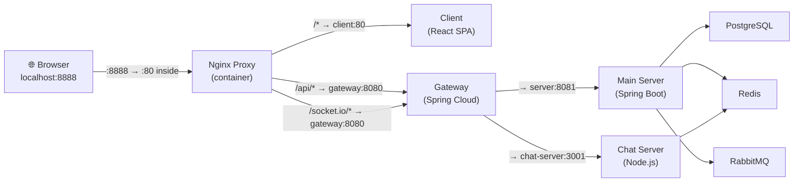
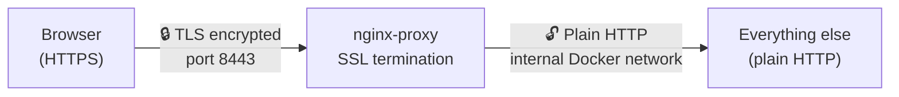
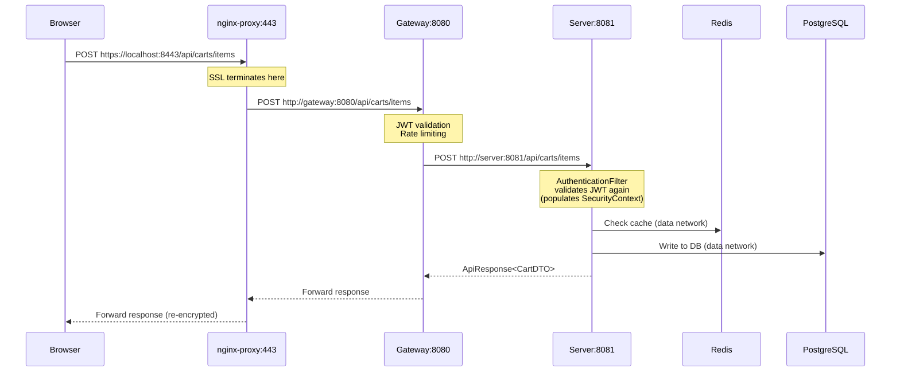

# How Ports, DNS, Redirects & Docker Networking Work

## The Big Picture



---

## 1. Docker Networks (The Virtual LANs)

Docker Compose creates **3 isolated bridge networks**, acting like separate VLANs:

| Network | Type | Purpose | Who's Connected |
|---------|------|---------|-----------------|
| **`frontend`** | bridge (public) | Services that need to talk to the outside world or each other via nginx | nginx-proxy, client, gateway, server, chat-server |
| **`backend`** | bridge (**internal**) | Service-to-service communication only — no outbound internet | nginx-proxy, gateway, server, chat-server |
| **`data`** | bridge (**internal**) | Database/cache access only — completely hidden from the edge | postgres, postgres-chat, redis, rabbitmq, server, gateway, chat-server |

> [!IMPORTANT]
> `internal: true` means containers on that network **cannot reach the internet** and **the host cannot reach them directly**. This is a security boundary — databases are never exposed to the host or outside world.

### Which service lives on which networks:

| Service | frontend | backend | data |
|---------|----------|---------|------|
| nginx-proxy | ✅ | ✅ | ❌ |
| client | ✅ | ❌ | ❌ |
| gateway | ✅ | ✅ | ✅ |
| server | ✅ | ✅ | ✅ |
| chat-server | ✅ | ✅ | ✅ |
| postgres | ❌ | ❌ | ✅ |
| redis | ❌ | ❌ | ✅ |
| rabbitmq | ❌ | ❌ | ✅ |

---

## 2. Docker DNS (How Containers Find Each Other)

Docker Compose has a **built-in DNS server**. Every service name in `docker-compose.yml` becomes a hostname resolvable by any container **on the same network**.

For example, when nginx-proxy config says:
```nginx
upstream gateway_upstream {
    server gateway:8080;
}
```

Docker's internal DNS resolves `gateway` → the IP address of the gateway container (e.g., `172.20.0.7`). This only works because both `nginx-proxy` and `gateway` share the `frontend` network.

Similarly:
- `server` resolves the main-server container (gateway → server communication over `backend`)
- `chat-server` resolves the chat container
- `postgres`, `redis`, `rabbitmq` resolve their respective containers (only from the `data` network)

> [!NOTE]
> These DNS names are **only valid inside Docker**. Your host machine cannot resolve `gateway` or `server` — it uses `localhost` with published ports instead.

---

## 3. Ports (`expose` vs `ports` — The Key Distinction)

### `expose` — Container-to-container only (no host access)
```yaml
server:
    expose:
      - "8081"    # Other containers can reach server:8081, but NOT localhost:8081
    
client:
    expose:
      - "80"      # Other containers can reach client:80, but NOT localhost:80
```

These ports are **only reachable from within Docker networks**. Your browser cannot connect to them.

### `ports` — Published to the host machine
```yaml
nginx-proxy:
    ports:
      - "0.0.0.0:${APP_PORT:-80}:80"      # host:8888 → container:80
      - "0.0.0.0:${APP_SSL_PORT:-443}:443" # host:8443 → container:443

gateway:
    ports:
      - "127.0.0.1:${GATEWAY_PORT:-8080}:8080"  # localhost:8080 → container:8080
```

The syntax is `HOST_IP:HOST_PORT:CONTAINER_PORT`:
- **`0.0.0.0:8888:80`** — binds host port 8888 on ALL interfaces (accessible from other machines on the network) and maps it to container port 80
- **`127.0.0.1:8080:8080`** — binds host port 8080 on **loopback only** (only accessible from localhost, not from other machines)

> [!TIP]
> The gateway port is bound to `127.0.0.1` for security — it should only be accessed through nginx-proxy in production. The `localhost:8080` binding exists for local dev/debugging.

---

## 4. The Port Mapping Chain (Your Setup)

With `APP_PORT=8888` and `APP_SSL_PORT=8443`:

```
Browser hits:  https://localhost:8443
                    ↓
Host port 8443  →  nginx-proxy container port 443 (SSL termination)
                    ↓
nginx-proxy routes based on URL path:
    /api/*        →  gateway:8080  (Docker DNS, frontend network)
    /socket.io/*  →  gateway:8080
    /*            →  client:80     (Docker DNS, frontend network)
                    ↓
gateway routes based on URL path:
    /api/*        →  server:8081   (Docker DNS, backend network)
    /socket.io/*  →  chat-server:3001
```

The **container ports never change** (nginx always listens on 80/443 inside, gateway on 8080, etc.). Only the **host-side mapping** changes via `.env`.

---

## 5. The HTTP→HTTPS Redirect (And the Port Gotcha)

In `nginx-proxy.conf`:
```nginx
server {
    listen 80;
    server_name _;
    return 301 https://$host$request_uri;
}
```

This redirects `http://` → `https://`. The problem with non-standard ports:

```
You visit:      http://localhost:8888
                    ↓
Host:8888  →  container:80  (nginx sees request on port 80)
                    ↓
Nginx redirects:  301 → https://localhost/...   ← uses $host = "localhost"
                                                    (no port info!)
```

`$host` is just `localhost` — nginx doesn't know about the host-side port `8443`. So it redirects to `https://localhost` (port 443), which hits your **other** nginx app.

**Workaround:** Access `https://localhost:8443` directly, skipping the HTTP→HTTPS redirect entirely.

> [!WARNING]
> In production with a real domain (e.g., `myshop.com`) on standard ports 80/443, this redirect works perfectly: `http://myshop.com` → `https://myshop.com`. The issue only exists in local dev with non-standard ports.

---

## 6. SSL/TLS (Where HTTPS Happens)



- SSL **terminates at nginx-proxy** — it holds the certificate (`./certs/cert.pem`)
- All internal traffic (nginx→gateway, gateway→server, etc.) is **plain HTTP** over Docker's internal networks
- This is safe because Docker's bridge networks are isolated — traffic never leaves the host machine

---

## 7. Request Lifecycle (Complete Path)

Here's what happens when a user clicks "Add to Cart":



---

## 8. Summary Table

| What | Where | Value |
|------|-------|-------|
| Browser entry point (HTTPS) | Host → nginx-proxy | `localhost:8443` → container `:443` |
| Browser entry point (HTTP) | Host → nginx-proxy | `localhost:8888` → container `:80` (redirects to HTTPS) |
| Gateway debug access | Host → gateway | `localhost:8080` → container `:8080` (loopback only) |
| nginx → client | Docker internal | `client:80` (frontend network, DNS) |
| nginx → gateway | Docker internal | `gateway:8080` (frontend network, DNS) |
| gateway → server | Docker internal | `server:8081` (backend network, DNS) |
| gateway → chat-server | Docker internal | `chat-server:3001` (backend network, DNS) |
| server → postgres | Docker internal | `postgres:5432` (data network, DNS) |
| server → redis | Docker internal | `redis:6379` (data network, DNS) |
| Databases accessible from host? | — | **No** (data network is `internal: true`) |
