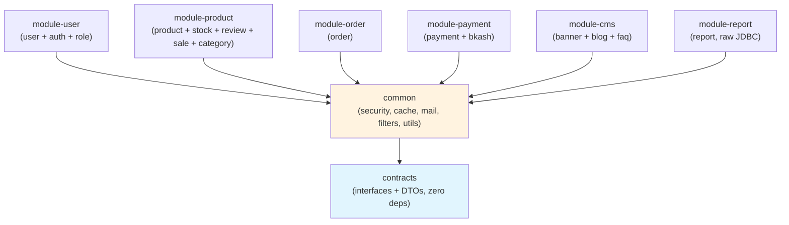

# Phase 3: Multi-Module Gradle Restructuring

## Goal

Convert the flat `server/` project into a Gradle multi-module monorepo where each domain is an independent library module. This enables:
- **`app-monolith`**: Single bootJar pulling all modules (current behavior, zero regression)
- **`app-product`**, **`app-order`**, **`app-payment`**: Independent bootJars with HTTP client configs

## Pausability

Each step below is independently committable. You can stop after any step and resume later. Steps are ordered by dependency — you cannot skip ahead.

```
Step 1 ──► Step 2 ──► Step 3 ──► Step 4 ──► Step 5 ──► Step 6 ──► Step 7 ──► Step 8
 Pre-work   Pre-work   Gradle     Move       Move       App        App        Docker
 Decouple   Move       Structure  Source     Tests &    Monolith   Services   Compose
 Common     CUDService             Files     Resources  Verify     + HTTP     Micro
```

---

## Dependency Graph (Research Result)



> [!IMPORTANT]
> **No module depends on another module.** All cross-domain communication goes through `contracts` (client interfaces) with adapter implementations within each module. The `common` module depends on `contracts` but NOT on any domain module.

### Cross-Domain Coupling (Must Fix First)

| Source File (in `common/`) | Imports From `user/` | Fix |
|---|---|---|
| `CustomUserDetails.java` | `UserStatus`, `User` | Move `UserStatus` to `common.enums`. Remove `User` constructor. |
| `CustomUserDetailsService.java` | `UserRepository`, `User` | Move entire class to `module-user` |

---

## Target Directory Structure

```
server/
├── settings.gradle                    # Multi-project includes
├── build.gradle                       # Root: shared plugins, dependency management, Java 21
│
├── contracts/                         # ── Zero-dependency contract JARs ──
│   ├── build.gradle                   # deps: spring-web (for @HttpExchange annotations only)
│   └── src/main/java/com/example/ecom/common/client/
│       ├── order/                     # OrderClient, OrderPaymentDto, OrderItemPaymentDto
│       ├── product/                   # ProductClient, ProductBasicDto
│       ├── stock/                     # StockClient
│       └── user/                      # UserClient, UserBasicDto
│
├── common/                            # ── Cross-cutting infrastructure ──
│   ├── build.gradle                   # deps: contracts, spring-boot-starters, redis, cache, etc.
│   └── src/main/java/com/example/ecom/common/
│   └── src/main/resources/
│       ├── logback-spring.xml
│       └── messages.properties
│
├── modules/
│   ├── module-user/                   # ── User + Auth + Role ──
│   │   ├── build.gradle              # deps: common
│   │   └── src/main/java/com/example/ecom/
│   │       ├── auth/
│   │       └── user/
│   │
│   ├── module-product/                # ── Product + Stock + Review + Sale + Category ──
│   │   ├── build.gradle              # deps: common
│   │   └── src/main/java/com/example/ecom/product/
│   │
│   ├── module-order/                  # ── Order ──
│   │   ├── build.gradle              # deps: common
│   │   └── src/main/java/com/example/ecom/order/
│   │
│   ├── module-payment/                # ── Payment + bKash ──
│   │   ├── build.gradle              # deps: common
│   │   └── src/main/java/com/example/ecom/payment/
│   │
│   ├── module-cms/                    # ── Banner + Blog + FAQ ──
│   │   ├── build.gradle              # deps: common
│   │   └── src/main/java/com/example/ecom/cms/
│   │
│   └── module-report/                 # ── Report (raw JDBC) ──
│       ├── build.gradle              # deps: common
│       └── src/main/java/com/example/ecom/report/
│
└── apps/
    ├── app-monolith/                  # ── THE MONOLITH (current behavior) ──
    │   ├── build.gradle              # deps: ALL modules
    │   ├── Dockerfile
    │   └── src/main/
    │       ├── java/com/example/ecom/MonolithApplication.java
    │       └── resources/
    │           ├── application.yml
    │           ├── application-prod.yml
    │           └── db/migration/      # ALL migrations (unified Flyway)
    │   └── src/test/                  # ALL tests (they test the assembled monolith)
    │       ├── java/com/example/ecom/
    │       └── resources/application.yml
    │
    ├── app-product/                   # ── Product Microservice ──
    │   ├── build.gradle              # deps: common, module-product
    │   └── src/main/
    │       ├── java/com/example/ecom/productapp/
    │       │   ├── ProductApplication.java
    │       │   └── config/HttpClientConfig.java
    │       └── resources/application.yml
    │
    ├── app-order/                     # ── Order Microservice ──
    │   └── ...
    │
    └── app-payment/                   # ── Payment Microservice ──
        └── ...
```

---

## Step 1: Decouple `CustomUserDetails` from `User` entity

> **Commit independently** ✅ | **Risk: Low** | **~15 min**

### Problem
`CustomUserDetails` (in `common.dto`) imports `user.user.enums.UserStatus` and `user.user.model.User`. In the multi-module world, `common` cannot depend on `module-user`.

### Changes

#### [MODIFY] `UserStatus.java` — move to `common.enums`
```bash
# Move the enum
mv server/src/main/java/com/example/ecom/user/user/enums/UserStatus.java \
   server/src/main/java/com/example/ecom/common/enums/UserStatus.java
# Update package declaration
sed -i 's/package com.example.ecom.user.user.enums/package com.example.ecom.common.enums/' \
   server/src/main/java/com/example/ecom/common/enums/UserStatus.java
# Fix all imports across the codebase
find server/src -name "*.java" -exec sed -i \
   's/import com.example.ecom.user.user.enums.UserStatus/import com.example.ecom.common.enums.UserStatus/g' {} +
```

#### [MODIFY] `CustomUserDetails.java` — remove `User` constructor
The class currently has 3 constructors:
1. `CustomUserDetails(UUID id, String name, String email, UserStatus status, Collection authorities)` ✅ stays
2. `CustomUserDetails(Claims claims)` ✅ stays (JJWT is a common dependency)
3. `CustomUserDetails(User user)` ❌ **remove** — move to a factory method in `module-user`

#### [NEW] `UserDetailsFactory.java` in `user.user.service`
```java
package com.example.ecom.user.user.service;

public final class UserDetailsFactory {
    public static CustomUserDetails fromUser(User user) {
        return new CustomUserDetails(
            user.getId(), user.getName(), user.getEmail(), user.getStatus(),
            user.getRoles().stream()
                .flatMap(role -> role.getPermissions().stream())
                .map(SimpleGrantedAuthority::new)
                .toList()
        );
    }
}
```

#### Fix all callers
Find every `new CustomUserDetails(user)` call and replace with `UserDetailsFactory.fromUser(user)`. These are in:
- `CustomUserDetailsService.loadUserByUsername()` → calls `new CustomUserDetails(user)`
- `AuthService` / `OAuthService` → likely calls `new CustomUserDetails(user)`
- Test files

### Verification
```bash
./gradlew compileJava compileTestJava test
```

---

## Step 2: Move `CustomUserDetailsService` to user package

> **Commit independently** ✅ | **Risk: Low** | **~10 min**

### Problem
`CustomUserDetailsService` (in `common.service`) imports `UserRepository`. It implements Spring Security's `UserDetailsService` for username/password authentication. Only the user-auth service needs it.

### Changes

#### [MOVE] `CustomUserDetailsService.java`
```bash
mv server/src/main/java/com/example/ecom/common/service/CustomUserDetailsService.java \
   server/src/main/java/com/example/ecom/user/user/service/CustomUserDetailsService.java
# Update package
sed -i 's/package com.example.ecom.common.service/package com.example.ecom.user.user.service/' \
   server/src/main/java/com/example/ecom/user/user/service/CustomUserDetailsService.java
# Fix imports in SecurityConfig and anywhere else
find server/src -name "*.java" -exec sed -i \
   's/import com.example.ecom.common.service.CustomUserDetailsService/import com.example.ecom.user.user.service.CustomUserDetailsService/g' {} +
```

#### [MODIFY] `SecurityConfig.java`
Update import. The `SecurityConfig` injects `CustomUserDetailsService` — in the multi-module world, `SecurityConfig` lives in `common` but `CustomUserDetailsService` lives in `module-user`. This is resolved by:
- `SecurityConfig` depends on `UserDetailsService` (Spring Security interface) not the concrete class
- Change the field type from `CustomUserDetailsService` to `UserDetailsService`

```java
// Before
private final CustomUserDetailsService userDetailsService;
// After
private final UserDetailsService userDetailsService;
```

#### [MOVE] `BkashConfigProperties.java` and `BkashWebClientConfig.java`
These are payment-specific but live in `common.config`. Move to `payment.config`:
```bash
mv server/src/main/java/com/example/ecom/common/config/BkashConfigProperties.java \
   server/src/main/java/com/example/ecom/payment/config/BkashConfigProperties.java
mv server/src/main/java/com/example/ecom/common/config/BkashWebClientConfig.java \
   server/src/main/java/com/example/ecom/payment/config/BkashWebClientConfig.java
```

### Verification
```bash
./gradlew compileJava compileTestJava test
```

---

## Step 3: Create Gradle Multi-Module Structure

> **Commit independently** ✅ | **Risk: Medium** | **~30 min**

This step creates the directory structure and Gradle build files WITHOUT moving any source code yet.

### Changes

#### [MODIFY] `server/settings.gradle`
```groovy
rootProject.name = 'ecom'

include 'contracts'
include 'common'
include 'modules:module-user'
include 'modules:module-product'
include 'modules:module-order'
include 'modules:module-payment'
include 'modules:module-cms'
include 'modules:module-report'
include 'apps:app-monolith'
```

#### [MODIFY] `server/build.gradle` — Root build (shared config only)
```groovy
plugins {
    id 'java'
    id 'org.springframework.boot' version '3.5.15' apply false
    id 'io.spring.dependency-management' version '1.1.7' apply false
    id 'jacoco'
}

ext {
    set('springCloudVersion', "2025.0.0")
}

subprojects {
    apply plugin: 'java'
    apply plugin: 'io.spring.dependency-management'

    group = 'com.example.ecom'
    version = '2026.5.0-SNAPSHOT'

    java {
        toolchain {
            languageVersion = JavaLanguageVersion.of(21)
        }
    }

    repositories {
        mavenCentral()
    }

    dependencyManagement {
        imports {
            mavenBom "org.springframework.cloud:spring-cloud-dependencies:${springCloudVersion}"
        }
    }

    dependencies {
        compileOnly 'org.projectlombok:lombok'
        annotationProcessor 'org.projectlombok:lombok'
    }

    test {
        useJUnitPlatform()
    }
}
```

#### [NEW] `server/contracts/build.gradle`
```groovy
dependencies {
    implementation 'org.springframework:spring-web'
}
```

#### [NEW] `server/common/build.gradle`
```groovy
dependencies {
    api project(':contracts')

    implementation 'org.springframework.boot:spring-boot-starter'
    implementation 'org.springframework.boot:spring-boot-starter-web'
    implementation 'org.springframework.boot:spring-boot-starter-data-jpa'
    implementation 'org.springframework.boot:spring-boot-starter-validation'
    implementation 'org.springframework.boot:spring-boot-starter-security'
    implementation 'org.springframework.boot:spring-boot-starter-cache'
    implementation 'org.springframework.boot:spring-boot-starter-data-redis'
    implementation 'org.springframework.boot:spring-boot-starter-aop'
    implementation 'org.springframework.boot:spring-boot-starter-json'
    implementation 'org.springframework.boot:spring-boot-starter-mail'
    implementation 'org.springframework.boot:spring-boot-starter-amqp'
    implementation 'org.springframework.boot:spring-boot-starter-actuator'

    implementation 'com.github.ben-manes.caffeine:caffeine'
    implementation 'com.giffing.bucket4j.spring.boot.starter:bucket4j-spring-boot-starter:0.12.0'
    implementation 'com.giffing.bucket4j.spring.boot.starter:bucket4j-redis:8.10.1'
    implementation 'redis.clients:jedis:5.1.0'
    implementation 'org.modelmapper:modelmapper:3.1.1'
    implementation 'com.fasterxml.jackson.datatype:jackson-datatype-jsr310'
    implementation 'net.logstash.logback:logstash-logback-encoder:8.0'
    implementation 'io.jsonwebtoken:jjwt-api:0.12.6'
    runtimeOnly 'io.jsonwebtoken:jjwt-impl:0.12.6'
    runtimeOnly 'io.jsonwebtoken:jjwt-jackson:0.12.6'
    implementation 'com.cloudinary:cloudinary-http44:1.39.0'
    implementation 'org.apache.tika:tika-core:3.2.2'
    implementation 'org.jsoup:jsoup:1.17.2'
    implementation 'org.springdoc:springdoc-openapi-starter-webmvc-ui:2.8.13'
    implementation 'io.micrometer:micrometer-registry-prometheus'
    implementation 'org.springframework.cloud:spring-cloud-context'
    implementation 'org.springframework.retry:spring-retry'
}
```

#### [NEW] `server/modules/module-user/build.gradle` (template for all modules)
```groovy
dependencies {
    implementation project(':common')
}
```

> [!NOTE]
> All domain modules have the same simple `build.gradle` except:
> - `module-payment` also needs `spring-boot-starter-webflux` (for bKash WebClient)
> - `module-user` also needs `spring-boot-starter-webflux` (for OAuth Google login)

#### [NEW] `server/apps/app-monolith/build.gradle`
```groovy
plugins {
    id 'org.springframework.boot'
}

dependencies {
    implementation project(':common')
    implementation project(':modules:module-user')
    implementation project(':modules:module-product')
    implementation project(':modules:module-order')
    implementation project(':modules:module-payment')
    implementation project(':modules:module-cms')
    implementation project(':modules:module-report')

    runtimeOnly 'org.postgresql:postgresql'
    implementation 'org.flywaydb:flyway-core'
    implementation 'org.flywaydb:flyway-database-postgresql'
    implementation 'me.paulschwarz:spring-dotenv:3.0.0'
    implementation 'com.h2database:h2'  // test profile

    testImplementation 'org.springframework.boot:spring-boot-starter-test'
}
```

> [!IMPORTANT]
> Only `app-monolith` (and future `app-*`) applies the `org.springframework.boot` plugin. Library modules (`contracts`, `common`, `modules/*`) do NOT apply it — they produce plain JARs, not bootJars.

#### Create empty directories
```bash
mkdir -p server/contracts/src/main/java/com/example/ecom/common/client
mkdir -p server/common/src/main/java/com/example/ecom/common
mkdir -p server/common/src/main/resources
mkdir -p server/modules/module-user/src/main/java/com/example/ecom
mkdir -p server/modules/module-product/src/main/java/com/example/ecom
mkdir -p server/modules/module-order/src/main/java/com/example/ecom
mkdir -p server/modules/module-payment/src/main/java/com/example/ecom
mkdir -p server/modules/module-cms/src/main/java/com/example/ecom
mkdir -p server/modules/module-report/src/main/java/com/example/ecom
mkdir -p server/apps/app-monolith/src/main/java/com/example/ecom
mkdir -p server/apps/app-monolith/src/main/resources/db/migration
mkdir -p server/apps/app-monolith/src/test/java/com/example/ecom
mkdir -p server/apps/app-monolith/src/test/resources
```

### Verification
```bash
cd server && ./gradlew projects  # Should list all subprojects
```

---

## Step 4: Move Source Files

> **Commit independently** ✅ | **Risk: High (big bang)** | **~45 min**

> [!CAUTION]
> This is the largest step. All file moves happen atomically. If interrupted, run `git checkout -- .` to restore.

### Move Script

```bash
cd server

# ── contracts/ ──
mv src/main/java/com/example/ecom/common/client/* contracts/src/main/java/com/example/ecom/common/client/

# ── common/ ──
# Move everything EXCEPT client/ (already moved) and the main app class
cp -r src/main/java/com/example/ecom/common/* common/src/main/java/com/example/ecom/common/
rm -rf common/src/main/java/com/example/ecom/common/client  # already in contracts

# ── module-user/ (user + auth) ──
mv src/main/java/com/example/ecom/user modules/module-user/src/main/java/com/example/ecom/
mv src/main/java/com/example/ecom/auth modules/module-user/src/main/java/com/example/ecom/

# ── module-product/ ──
mv src/main/java/com/example/ecom/product modules/module-product/src/main/java/com/example/ecom/

# ── module-order/ ──
mv src/main/java/com/example/ecom/order modules/module-order/src/main/java/com/example/ecom/

# ── module-payment/ ──
mv src/main/java/com/example/ecom/payment modules/module-payment/src/main/java/com/example/ecom/

# ── module-cms/ ──
mv src/main/java/com/example/ecom/cms modules/module-cms/src/main/java/com/example/ecom/

# ── module-report/ ──
mv src/main/java/com/example/ecom/report modules/module-report/src/main/java/com/example/ecom/

# ── app-monolith/ ──
mv src/main/java/com/example/ecom/EcomApplication.java apps/app-monolith/src/main/java/com/example/ecom/MonolithApplication.java
# Rename class inside the file
sed -i 's/EcomApplication/MonolithApplication/g' apps/app-monolith/src/main/java/com/example/ecom/MonolithApplication.java

# Clean up old src/main/java (should be empty now)
rm -rf src/main/java/com/example/ecom/common/
```

> [!WARNING]
> After moving, the old `src/main/java` should only contain empty directories. Verify with `find src/main/java -name "*.java"` — should return nothing.

### Verification
```bash
./gradlew compileJava  # All modules should compile
```

---

## Step 5: Move Tests & Resources → `app-monolith`

> **Commit independently** ✅ | **Risk: Medium** | **~20 min**

### Move Resources

```bash
cd server

# Common resources
mv src/main/resources/logback-spring.xml common/src/main/resources/
mv src/main/resources/messages.properties common/src/main/resources/

# App-monolith resources (application configs + migrations)
mv src/main/resources/application.yml apps/app-monolith/src/main/resources/
mv src/main/resources/application-prod.yml apps/app-monolith/src/main/resources/
mv src/main/resources/db apps/app-monolith/src/main/resources/

# Test resources & test source
cp -r src/test/java/com/example/ecom/* apps/app-monolith/src/test/java/com/example/ecom/
mv src/test/resources/application.yml apps/app-monolith/src/test/resources/

# Clean up old src/ directories
rm -rf src/
```

> [!NOTE]
> **All tests stay in `app-monolith/src/test/`** for now. This is correct because:
> 1. Tests need the assembled monolith to run (Spring context with all beans)
> 2. Integration tests load `EcomApplication` (now `MonolithApplication`)
> 3. Unit tests can remain here since `app-monolith` transitively depends on all modules
>
> Future optimization: move pure unit tests (no Spring context) into their respective modules.

### Verification
```bash
./gradlew :apps:app-monolith:compileTestJava
./gradlew :apps:app-monolith:test
```

---

## Step 6: Verify Monolith Works End-to-End

> **Commit independently** ✅ (Dockerfile update) | **Risk: Medium** | **~15 min**

### Update Dockerfile

The current `server/Dockerfile` builds from the root. Update it to build `app-monolith`:

#### [MODIFY] `server/Dockerfile`
```dockerfile
FROM eclipse-temurin:21-jdk-alpine AS build
WORKDIR /app
COPY gradlew .
COPY gradle gradle
COPY build.gradle .
COPY settings.gradle .
# Copy all subproject build files
COPY contracts/build.gradle contracts/build.gradle
COPY common/build.gradle common/build.gradle
COPY modules/ modules/
COPY apps/app-monolith/build.gradle apps/app-monolith/build.gradle
RUN sed -i 's/\r$//' gradlew
RUN chmod +x gradlew
RUN ./gradlew dependencies --no-daemon
# Copy all source
COPY contracts/src contracts/src
COPY common/src common/src
COPY modules/ modules/
COPY apps/app-monolith/src apps/app-monolith/src
RUN ./gradlew :apps:app-monolith:bootJar --no-daemon

FROM eclipse-temurin:21-jre-alpine
# ... (same runtime stage, but JAR path changes)
COPY --from=build /app/apps/app-monolith/build/libs/*.jar app.jar
```

### Update `docker-compose.yml`
The `server` service build context may need updating if it points to `server/`.

### Verification
```bash
# Local compile + test
./gradlew :apps:app-monolith:test

# Docker build
docker compose build server

# Full stack
docker compose up -d
docker logs ecom-server-1 --tail 30
docker logs ecom-smoke-test-1
```

---

## Step 7: Create Per-Service Apps (Product, Order, Payment)

> **Commit independently** ✅ | **Risk: Low** | **~30 min**

Each per-service app needs:
1. An `Application.java` main class with explicit `scanBasePackages`
2. A `HttpClientConfig.java` that creates HTTP proxy beans for other domains' clients
3. An `application.yml` with service URLs

### Example: `app-order`

#### [NEW] `server/apps/app-order/build.gradle`
```groovy
plugins {
    id 'org.springframework.boot'
}

dependencies {
    implementation project(':common')
    implementation project(':modules:module-order')

    runtimeOnly 'org.postgresql:postgresql'
    implementation 'org.flywaydb:flyway-core'
    implementation 'org.flywaydb:flyway-database-postgresql'
    implementation 'me.paulschwarz:spring-dotenv:3.0.0'
}
```

#### [NEW] `OrderApplication.java`
```java
@SpringBootApplication(scanBasePackages = {
    "com.example.ecom.common",
    "com.example.ecom.order"
})
@ConfigurationPropertiesScan
@EnableJpaAuditing(auditorAwareRef = "auditorAwareImpl")
public class OrderApplication {
    public static void main(String[] args) {
        SpringApplication.run(OrderApplication.class, args);
    }
}
```

#### [NEW] `HttpClientConfig.java`
```java
@Configuration
public class HttpClientConfig {

    @Value("${services.product.url}")
    private String productServiceUrl;

    @Value("${app.internal.service-key}")
    private String internalKey;

    @Bean
    public ProductClient productClient(RestClient.Builder builder) {
        RestClient restClient = builder
                .baseUrl(productServiceUrl)
                .defaultHeader(SecurityUtil.INTERNAL_SERVICE_KEY_HEADER, internalKey)
                .build();
        return HttpServiceProxyFactory
                .builderFor(RestClientAdapter.create(restClient))
                .build()
                .createClient(ProductClient.class);
    }

    @Bean
    public StockClient stockClient(RestClient.Builder builder) {
        RestClient restClient = builder
                .baseUrl(productServiceUrl)  // Stock is in same service as Product
                .defaultHeader(SecurityUtil.INTERNAL_SERVICE_KEY_HEADER, internalKey)
                .build();
        return HttpServiceProxyFactory
                .builderFor(RestClientAdapter.create(restClient))
                .build()
                .createClient(StockClient.class);
    }
}
```

#### [NEW] `apps/app-order/src/main/resources/application.yml`
```yaml
app:
  internal:
    service-key: ${INTERNAL_SERVICE_KEY}

services:
  product:
    url: ${PRODUCT_SERVICE_URL:http://product-service:8081}
  user:
    url: ${USER_SERVICE_URL:http://user-auth-service:8081}

spring:
  datasource:
    url: ${DB_URL}
    username: ${DB_USERNAME}
    password: ${DB_PASSWORD}
  flyway:
    locations: classpath:db/migration/order
```

### Service → Client Dependencies

| App | Needs These HTTP Clients | Doesn't Need (has locally) |
|---|---|---|
| `app-order` | `ProductClient`, `StockClient` | `OrderClient` (has module-order) |
| `app-product` | `UserClient` | `ProductClient`, `StockClient` (has module-product) |
| `app-payment` | `OrderClient`, `ProductClient` | — |

### Verification
```bash
./gradlew :apps:app-order:compileJava
./gradlew :apps:app-product:compileJava
./gradlew :apps:app-payment:compileJava
```

---

## Step 8: Docker Compose for Microservices

> **Commit independently** ✅ | **Risk: Low** | **~20 min**

#### [NEW] `docker-compose.micro.yml`

```yaml
services:
  user-auth-service:
    build:
      context: ./server
      dockerfile: apps/app-user/Dockerfile
    environment:
      - INTERNAL_SERVICE_KEY=${INTERNAL_SERVICE_KEY}
      - DB_URL=${DB_URL}
    networks: [backend, data]

  product-service:
    build:
      context: ./server
      dockerfile: apps/app-product/Dockerfile
    environment:
      - INTERNAL_SERVICE_KEY=${INTERNAL_SERVICE_KEY}
      - USER_SERVICE_URL=http://user-auth-service:8081
    networks: [backend, data]

  order-service:
    build:
      context: ./server
      dockerfile: apps/app-order/Dockerfile
    environment:
      - INTERNAL_SERVICE_KEY=${INTERNAL_SERVICE_KEY}
      - PRODUCT_SERVICE_URL=http://product-service:8081
    networks: [backend, data]

  payment-service:
    build:
      context: ./server
      dockerfile: apps/app-payment/Dockerfile
    environment:
      - INTERNAL_SERVICE_KEY=${INTERNAL_SERVICE_KEY}
      - ORDER_SERVICE_URL=http://order-service:8081
      - PRODUCT_SERVICE_URL=http://product-service:8081
    networks: [backend, data]
```

#### Gateway Microservice Routes
Add a `gateway/src/main/resources/application-microservice.yml`:
```yaml
spring:
  cloud:
    gateway:
      routes:
        - id: user-auth
          uri: http://user-auth-service:8081
          predicates:
            - Path=/auth/**,/users/**,/roles/**
        - id: product
          uri: http://product-service:8081
          predicates:
            - Path=/products/**,/categories/**,/reviews/**,/stock/**,/sales/**
        - id: order
          uri: http://order-service:8081
          predicates:
            - Path=/orders/**
        - id: payment
          uri: http://payment-service:8081
          predicates:
            - Path=/payment/**
```

### Verification
```bash
# Monolith still works
docker compose up -d
docker logs ecom-smoke-test-1

# Microservices work
docker compose -f docker-compose.micro.yml up -d
```

---

## Open Questions

> [!IMPORTANT]
> **Q1: Flyway migration splitting** — The current `V1__init_schema.sql` has all tables in one file with cross-domain FKs. For per-service apps, we need per-domain migration files. Two options:
> - **Option A**: Keep the monolithic migration in `app-monolith` only. Per-service apps connect to the same pre-migrated DB (simplest, works for shared-DB).
> - **Option B**: Split V1 into per-domain files now. Each app runs only its domain's migrations.
>
> **Recommendation**: Option A for now. Split when moving to database-per-service.

> [!IMPORTANT]
> **Q2: `UserStatusConverter`** — The `UserStatusConverter` (JPA `@Converter`) is in `user.user.converter` and references `UserStatus`. Since `UserStatus` moves to `common.enums` in Step 1, the converter import changes but stays in the user module. Same for `OrderStatusConverter`. No issue, just noting.

> [!IMPORTANT]
> **Q3: `SecurityConfig` in multi-module** — `SecurityConfig` has endpoint rules for ALL domains (`/products`, `/orders`, `/payment/callback`, etc.). In monolith, this is fine. In per-service apps, each app only has its own endpoints. Options:
> - **Option A**: Keep `SecurityConfig` in common with all rules (harmless — unmatched rules are ignored).
> - **Option B**: Split into per-domain security configs.
>
> **Recommendation**: Option A for now. Simpler, no risk.

---

## Verification Plan

### After Each Step
```bash
cd server
JAVA_HOME=/usr/local/jdk21 PATH=/usr/local/jdk21/bin:$PATH ./gradlew compileJava compileTestJava
```

### After Step 5 (full monolith test)
```bash
JAVA_HOME=/usr/local/jdk21 PATH=/usr/local/jdk21/bin:$PATH ./gradlew :apps:app-monolith:test --rerun-tasks
```

### After Step 6 (Docker verification)
```bash
docker compose down -v
docker compose build server
docker compose up -d
docker logs ecom-smoke-test-1  # All 8 tests must pass
```

### After Step 7 (per-service compile)
```bash
./gradlew :apps:app-order:compileJava
./gradlew :apps:app-product:compileJava
./gradlew :apps:app-payment:compileJava
```
