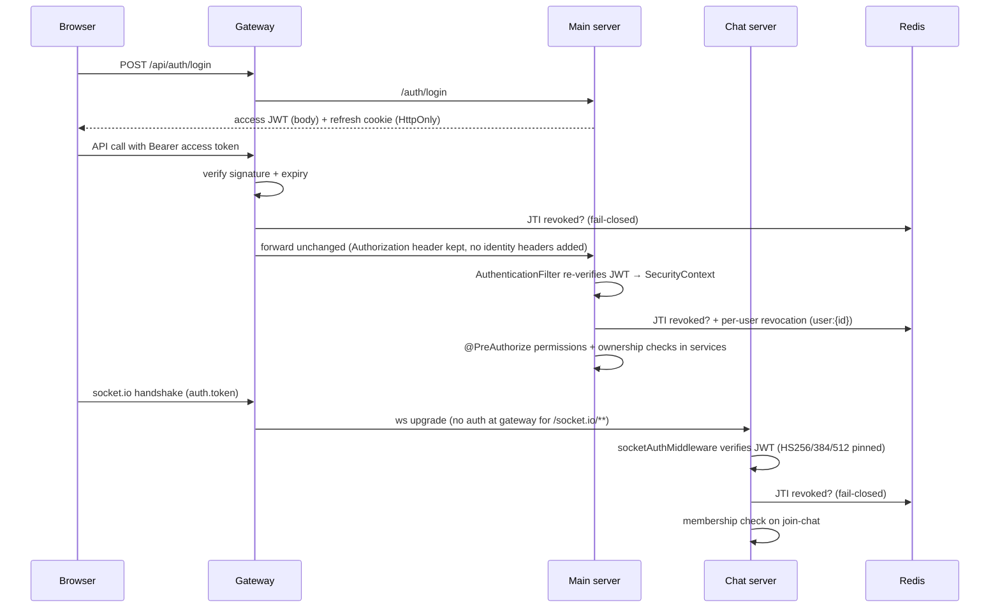

# Security

## Authentication Architecture

### Token Strategy
- **Access Token** — HMAC-signed JWT (HS*), 15 min (`jwt.access-token.expiration: 900`). Held **in memory only** on the client (never localStorage). Validated independently by the Gateway, the Main Server and the Chat Server.
- **Refresh Token** — 7 days, stored as an `HttpOnly` cookie (name from `REFRESH_TOKEN_NAME`), persisted server-side by JTI in `user_refresh_tokens` and rotated on every refresh.
- Both token secrets are in env vars: `ACCESS_TOKEN_SECRET`, `REFRESH_TOKEN_SECRET`. They must be independent random values of ≥256 bits. Because validation is symmetric (HMAC), every service holding `ACCESS_TOKEN_SECRET` can also *sign* tokens — keep it out of any container that doesn't validate tokens.

### JWT Validation Flow



- The Gateway **does not inject** `X-User-Id` / role headers, and no downstream service reads such headers. Each service re-verifies the bearer token itself, so reaching a service directly does not bypass authentication.
- `@AuthenticationPrincipal CustomUserDetails` in the Main Server is built from the token's claims (id, permissions, status).
- `/internal/**` is `denyAll` at the Gateway and additionally requires `X-Internal-Service-Key` at the Main Server.
- Individual microservices must **never** configure their own CORS.

| Check | Gateway | Main Server | Chat Server |
|---|---|---|---|
| Signature + expiry | ✅ | ✅ | ✅ (handshake + REST) |
| Revoked JTI (`v1:revokedAccessTokens::{jti}`) | ✅ (15s Caffeine cache) | ✅ | ✅ |
| Per-user revocation (`…::user:{id}`, written on ban / password reset) | ❌ | ✅ | ❌ |
| Re-check on long-lived socket | n/a | n/a | ❌ (handshake only) |

### Socket.IO Authentication
- All WebSocket connections pass through `socketAuthMiddleware` before being allowed to join any room.
- On `connect_error` with "Unauthorized", the client attempts an access token refresh via `socket.js`.

### Token Revocation
- On logout or account suspension, tokens are invalidated via Redis (`SET NX PX` atomic lock with key `v1:revokedAccessTokens::{jti}`).
- The Gateway has direct access to the `data` network for Redis-based revocation checks.
- **Fail-Closed Resilience:** Gateway holds an in-memory Caffeine cache (valid JTIs: 15s TTL; revoked JTIs: 10m TTL) to absorb short Redis hiccups. If Redis is down for longer than 15 seconds, the Gateway **fails closed** with HTTP `503 Service Unavailable`. It never fails open, ensuring revoked or banned tokens cannot be used during an outage.
- Chat Server's `socketAuthMiddleware` also validates the `jti` against Redis and fails closed on connection handshake.

---

## Authorization (RBAC)

### Server-Side Enforcement
- Use `@PreAuthorize` with `Permission` enum values for role-based access:
  ```java
  @PreAuthorize("hasAuthority(T(com.example.Permission).ADMIN_ACCESS.getValue())")
  ```
- Use `@PostAuthorize` for resource ownership checks (data-level security):
  ```java
  @PostAuthorize("returnObject.user.id == principal.id")
  ```

### Roles & Permissions
Defined in `common/enums/Permission.java`:

| Permission (value)                          | Access Level                                  |
|---------------------------------------------|-----------------------------------------------|
| `SUPER_ADMIN_ACCESS` (`super_admin:access`) | Everything; exclusively: role management, user role/status changes, product create/edit/delete, stock create/edit/delete, sales |
| `ADMIN_ACCESS` (`admin:access`)             | All orders + status changes, users (view), roles (view), stock (view), reports, categories, CMS (banners, blogs, FAQs), payment query/refund |
| `DELIVERY_MAN_ACCESS` (`delivery_man:access`) | Lists SHIPPED/DELIVERED/RETURNED orders; may set only DELIVERED (also marks paid) or RETURNED |
| `USER` (`user:access`)                      | Own profile, own orders (view/cancel while PENDING), own payments, own reviews |

Object-level checks live in the services (e.g. `OrderService.findById/cancel`, `BkashPaymentService.create`, `ReviewService.update/delete`), not only in `@PreAuthorize`.

- **User Moderation:** Suspend, ban, or delete accounts triggers instant cache eviction for that user.

---

## CORS

- In production, CORS is effectively **eliminated** by same-origin routing through `nginx-proxy` — all traffic (API, WebSocket, and static assets) is served from the same origin.
- The Gateway's CORS configuration (`CORS_ALLOWED_ORIGINS` = `CLIENT_URL`) is retained as a **defense-in-depth safety net** for local development and as a fallback if requests somehow bypass the proxy.
- Individual services (`server`, `chat-server`) do NOT configure CORS independently.

---

## Rate Limiting

- Implemented via `IpRateLimiterFilter` using **Bucket4j** with Redis backing.
- **Dev/test mode** falls back to local Caffeine cache.
- **Client IP derivation (`IpRateLimiterFilter`)**: `X-Forwarded-For` / `X-Real-IP` are only trusted when the TCP peer is listed in `TRUSTED_PROXY_IPS`. If that variable is empty, the key is the peer address — i.e. the `nginx-proxy` container — so **all users share one bucket**. When trusting nginx, nginx must *overwrite* `X-Forwarded-For` (`$remote_addr`), not append (`$proxy_add_x_forwarded_for`), otherwise clients can choose their own key.
- Limits (`gateway/application.yml` → `rate-limit`): global 2000/min, per-IP 100/min (20 concurrent), auth 20/min (5 concurrent), per-user 300/min. The auth limit is selected by a path-prefix match in `IpRateLimiterFilter` and must match the `/api/auth` prefix the gateway actually sees.
- `/actuator/**` and `/socket.io/**` are excluded from gateway rate limiting.
- There is no per-account login lockout; OTP verification allows 3 tries per code (`rate-limit.otp.max-tries`).
- **Chat Server Rate Limiting:**
  - Message send: Redis sliding window of **20 messages per 10 seconds** per user (`ratelimit:msg:{userId}`). Falls back to an in-memory limit of 5 msgs/sec per socket if Redis is unavailable.
  - Typing indicators: Throttled to **1 event per 2 seconds** per user per chat via Redis `NX` (`typing:{chatId}:{userId}`). Verified via in-memory room authorization (`socket.rooms.has`).

---

## Idempotency

- All mutating financial/critical-state endpoints (`POST /orders`, `POST /payment`) support the `Idempotency-Key` request header.
- **Dual-Layer Protection:**
  1. **Fast Concurrency Defense (Redis):** Handled by `IdempotencyAspect` + `IdempotencyService` using Redis atomic locks (`SET NX PX` 30s) and cached response payloads. Payload hash mismatches return HTTP `422 Unprocessable Entity`.
  2. **Hard Persistence Defense (PostgreSQL):** `V1__init_schema.sql` defines `orders.idempotency_key VARCHAR(64) NOT NULL` with `CONSTRAINT uq_orders_user_idempotency UNIQUE (user_id, idempotency_key)`. `IdempotencyAspect` rejects `@Idempotent` requests without the header (400).
  - Scope: the Redis cache key is `idempotencyKey + payload hash` — it is not namespaced per user or endpoint. Payments have **no** DB-level uniqueness (see [audit F-02](../.context/2026-10-25-system-audit.md)).
  3. **Outage Resilience:** If Redis is down, `IdempotencyAspect` catches `RedisConnectionFailureException`, logs a warning, and falls back directly to the database constraint. Duplicate submissions are strictly prevented even during complete Redis outages.

---

## Request Logging & Credential Masking

- `LoggingFilter` assigns a distributed MDC `requestId` for tracing across services.
- `LoggingFilter` masks sensitive **query-string** parameters (`token`, `password`, `secret`, `phone`, …) before logging the URL. Request bodies are not masked — never log raw request DTOs (see [privacy-data.md](./privacy-data.md#5-personal-data-in-logs)).
- Do not log raw request bodies that may contain passwords, tokens, or payment data.

---

## Infrastructure Security

- **`nginx-proxy`** is the **sole public entry point** — it exposes `0.0.0.0:${APP_PORT:-80}:80` on the host, making it the only container reachable from the internet.
- **`gateway`** is bound to `127.0.0.1:8080` — accessible for local development only, not publicly exposed.
- **`client`** uses `expose: 80` (internal Docker network only) — **no host port** is mapped at all.
- PostgreSQL, Redis, and RabbitMQ are on the internal `data` network — **never exposed** to the `frontend` network.
- No data-layer service has a host-mapped port in production.
- Redis requires password auth (`REDIS_PASSWORD` env var, `--requirepass` flag).
- Database backup files are AES-256-CBC encrypted at rest (`BACKUP_ENCRYPTION_KEY`). **Change this before production deployment.**
- `BACKUP_ENCRYPTION_KEY` default value in `.env` (`change-me-before-production`) must be replaced before any production deployment.
- **Docker networks** are plain bridges (none is `internal: true`); isolation relies on which networks each service joins and on only nginx publishing ports.
- **`env_file: .env`** is attached to most services, so every such container receives every secret in `.env`. Prefer per-service `environment:` entries.
- **Image contents**: services that `COPY . .` (chat-server) need a `.dockerignore` excluding `.env`, `node_modules`, `logs`.

### Actuator & API Docs Exposure

| Service | Exposed endpoints | Who can reach them |
|---|---|---|
| Gateway | `health` (details always), `info`, `metrics`, `prometheus`, `refresh` — no prod override | `/actuator/**` is `permitAll` and nginx forwards `/actuator` → **public**; `POST /actuator/refresh` requires `X-Internal-Service-Key` |
| Main Server (prod profile) | `health` (no details), `prometheus` | Via gateway `/api/actuator/**` → any authenticated user |
| Swagger / `/v3/api-docs` | Disabled in the prod profile on both Spring services | — |

---

## Payment Security (bKash)

- bKash credentials (`BKASH_APP_KEY`, `BKASH_APP_SECRET`, `BKASH_USERNAME`, `BKASH_PASSWORD`) are environment-only — never committed to source.
- Callback endpoint is `GET /api/payment/callback` (`PaymentController`, `@RequestMapping("/payment")`), the only payment route permitted without a token at the Gateway. `BKASH_CALLBACK_URL` must point at `${SERVER_URL}/api/payment/callback` where `SERVER_URL` is the public HTTPS origin. (`docker-compose.yml` currently sets `/api/payments/bkash/callback`, which does not exist — [audit F-03](../.context/2026-10-25-system-audit.md).)
- The callback carries no signature; success is established only by the server-to-server `/execute` call. The amount sent to bKash always comes from `order.totalPrice`, never from the client.
- `POST /payment/refund` and `GET /payment/query/{id}` are admin-only.
- Current integration uses the **sandbox** environment. Swap `BKASH_BASE_URL` to the production URL for live payments.

---

## Threat Model Summary

| Threat                          | Mitigation                                              |
|---------------------------------|---------------------------------------------------------|
| Stolen JWT                      | Short expiry + Redis revocation on logout               |
| Unauthorized API access         | Gateway `AuthenticationFilter` + `@PreAuthorize` RBAC  |
| Cross-site data leakage         | Same-origin via Nginx proxy; CORS at Gateway as defense-in-depth |
| Duplicate payments              | Idempotency key + Redis atomic lock                     |
| IP-based abuse / DDoS           | Bucket4j rate limiting per IP with Redis backing        |
| WebSocket abuse                 | `socketAuthMiddleware` + 20 msgs / 10 s per user (Redis), room-membership checks |
| Log credential exposure         | `LoggingFilter` masks sensitive fields                  |
| Backup data breach              | AES-256-CBC encryption at rest                          |
